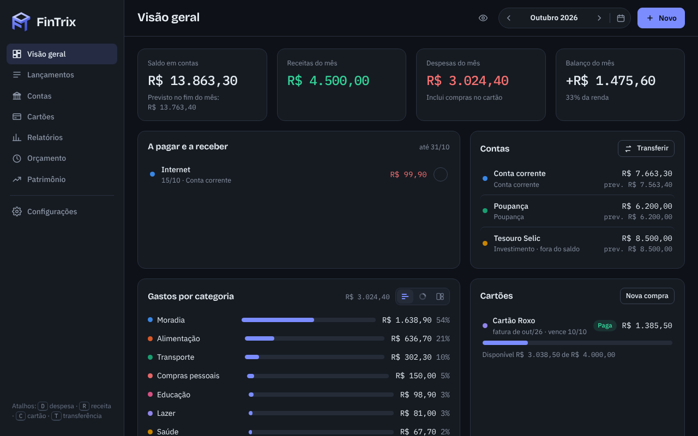
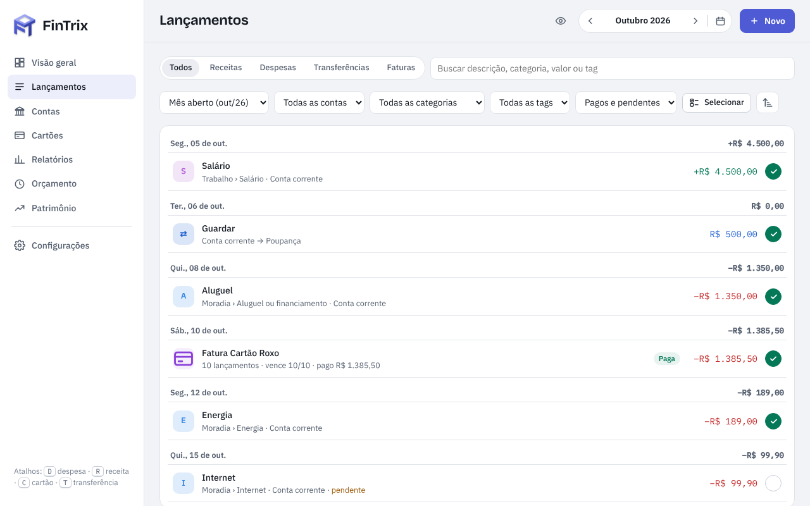
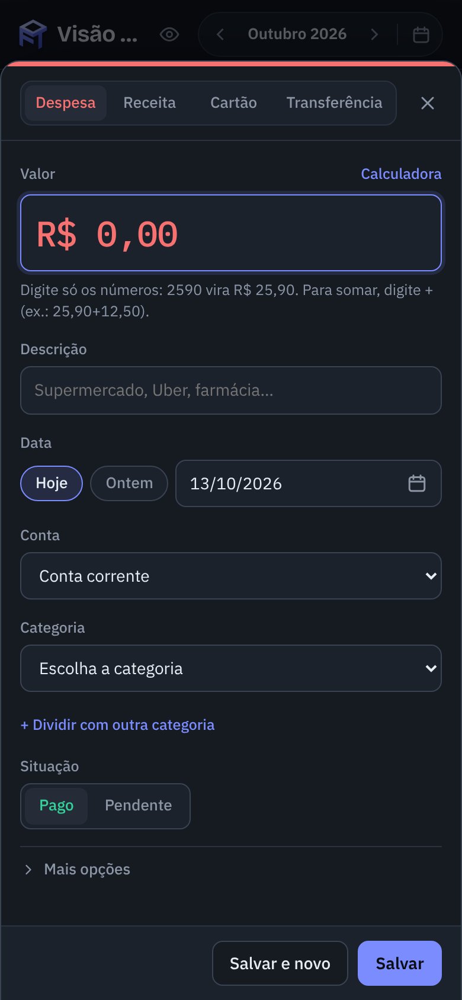

<p align="center">
  
</p>

<h1 align="center">FinTrix</h1>

<p align="center">Controle financeiro pessoal: contas, cartões, faturas, orçamento e relatórios.<br>
Um app web em um arquivo só, sem instalação e sem servidor.</p>

<p align="center">
  
</p>

## O que ele faz

- **Lançamentos rápidos** numa janela só, com quatro abas: Despesa, Receita, Cartão e Transferência. O campo de valor aceita contas (25,90+12,50), um lançamento pode ser dividido entre categorias e as datas são sempre DD/MM/AAAA, com calendário.
- **Contas** corrente, poupança, carteira, benefícios e investimentos, com saldo atual, saldo previsto no fim do mês e ajuste de saldo.
- **Cartões de crédito** com a fatura calculada pelo dia de fechamento, limite disponível, pagamento e ajuste de fatura.
- **Fixas e parcelados.** As fixas podem repetir todo mês ou a cada 2, 3, 6 ou 12 meses, inclusive com valor variável (luz, água). Os parcelados aceitam informar a parcela atual. Um lançamento pode virar único, fixo ou parcelado depois de salvo.
- **Orçamento** por categoria, com histórico mês a mês, previsão de fechamento e aviso a partir de 80% do limite, já na janela de lançamento.
- **Relatórios** por categoria e por tag, com análise mensal ou anual e gráficos em barras, rosca ou blocos.
- **Patrimônio e metas**, importação de extrato e fatura (CSV e OFX) e comprovantes anexados aos lançamentos.
- **No dia a dia:** busca em qualquer período, seleção múltipla para editar ou excluir vários lançamentos, Desfazer depois de excluir, modo discreto (esconde os valores), tema escuro e claro e atalhos de teclado (D, R, C, T).
- **Seus dados:** backup e restauração em JSON e exportação em CSV (abre no Excel e no OnlyOffice).

<p align="center">
  
  
</p>

## Como usar

O app inteiro é o [`index.html`](index.html).
Também pode ser acessado a partir de https://hudsonjunior42.github.io/FinTrix/

## Estrutura

```
index.html            o app completo (HTML, CSS e JavaScript num arquivo só)
assets/               logo (SVG e PNG)
docs/
  especificacao.md    regras e decisões do app (fonte de verdade para mudanças)
  rodar-localmente.md uso fora do claude.ai e migração dos dados
  pwa.md              instruções do pacote instalável (vai junto com ele)
  img/                capturas de tela deste README
tools/
  pwa_build.py        gera o pacote instalável (PWA) em dist/pwa/
  capturas.py         gera as capturas de tela de docs/img/ com dados fictícios
test/
  ui/                 testes de interface com banco simulado (um arquivo por funcionalidade)
  v1.py, v11.py       testes de integração das versões 1.0 e 1.1 (segurança dos dados, importação, migração)
  regressao.py        compara duas versões do app com a mesma base grande
  pwa_v1.py           testa o pacote instalável (offline, atualização)
```

## Desenvolvimento

- **Sem build e sem dependências.** É JavaScript puro num arquivo só. As fontes vêm do Google Fonts.
- **Camada de dados.** Todo acesso a dados passa pelo bloco "camada de dados" no início do script (`Backends.local`). Para hospedar com sincronização própria (PocketBase, Supabase…), basta acrescentar outro backend que cumpra o mesmo contrato.
- **Valores em centavos** (inteiros), datas `AAAA-MM-DD` e meses `AAAA-MM`.
- **Testes** com Playwright (Python). Como instalar e rodar: [test/README.md](test/README.md).

### Versão instalável (PWA)

O `tools/pwa_build.py` gera um pacote que instala como app no celular e no computador e funciona sem internet. Ele está pronto e testado, mas a publicação fica para a versão 1.0.

```bash
python3 tools/pwa_build.py   # saída em dist/pwa/ (fora do Git)
```

## Licença

[MIT](LICENSE) © 2026 Hudson Santos Menezes Júnior
